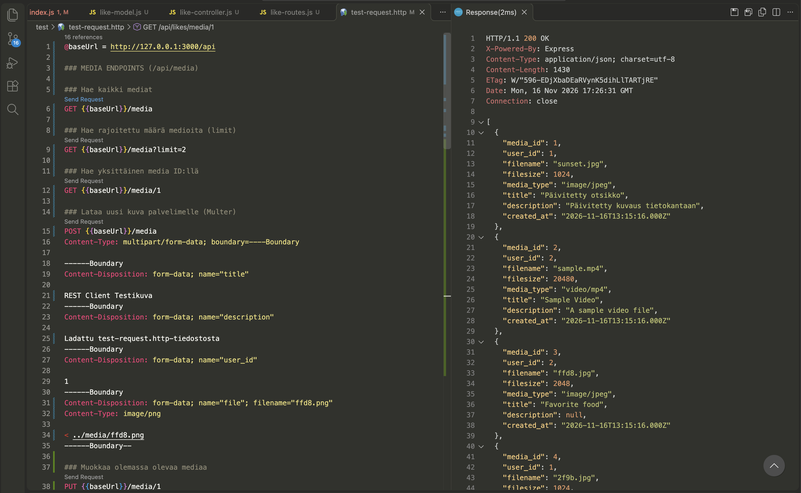
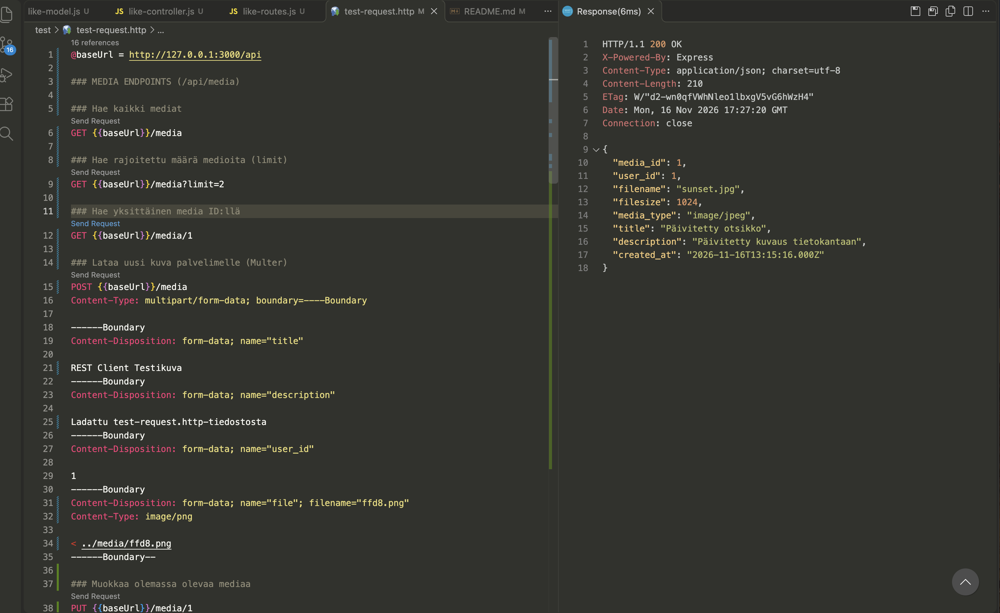
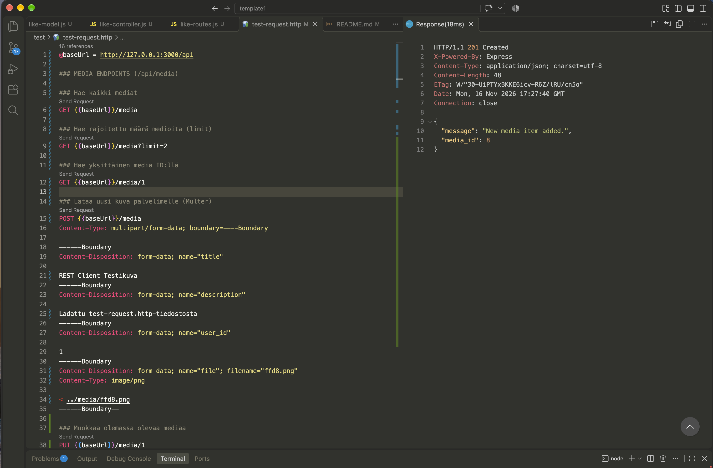
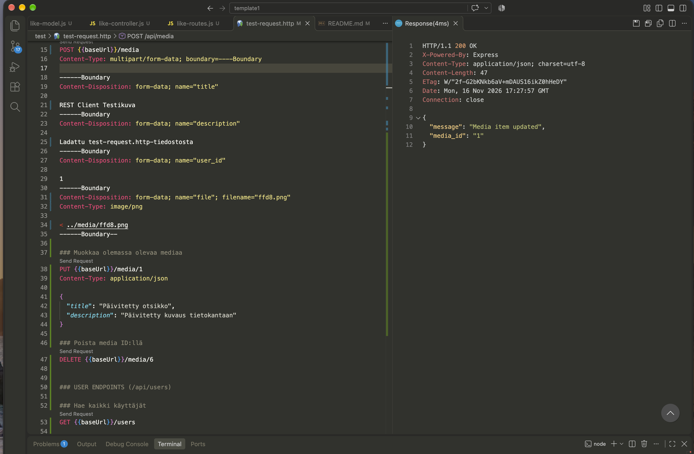
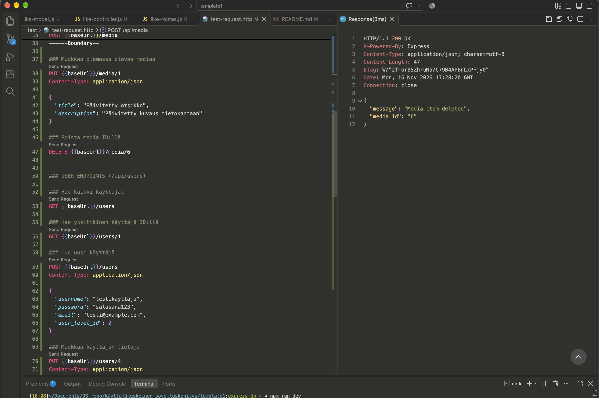
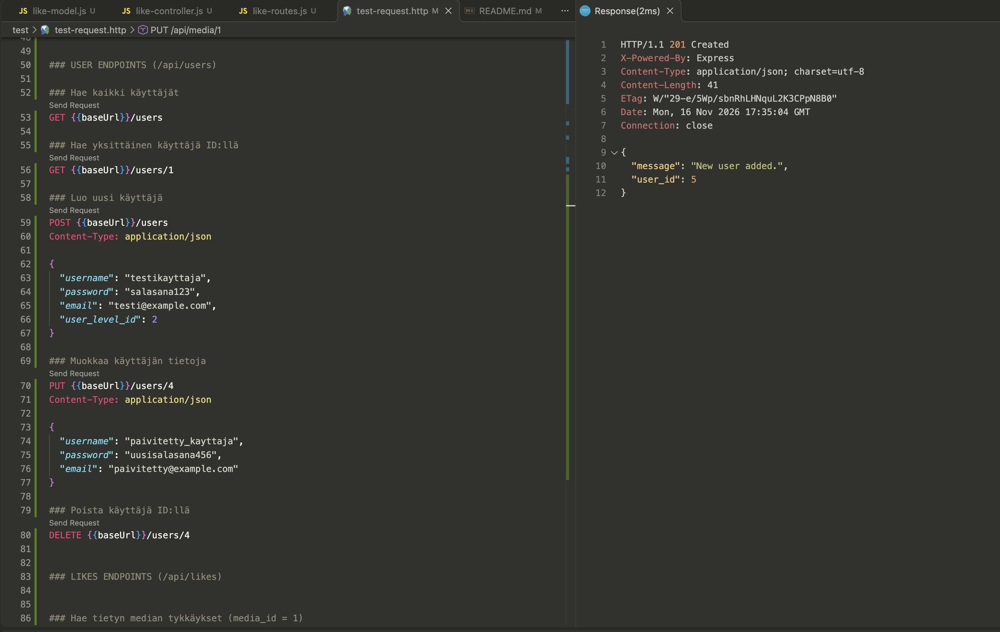
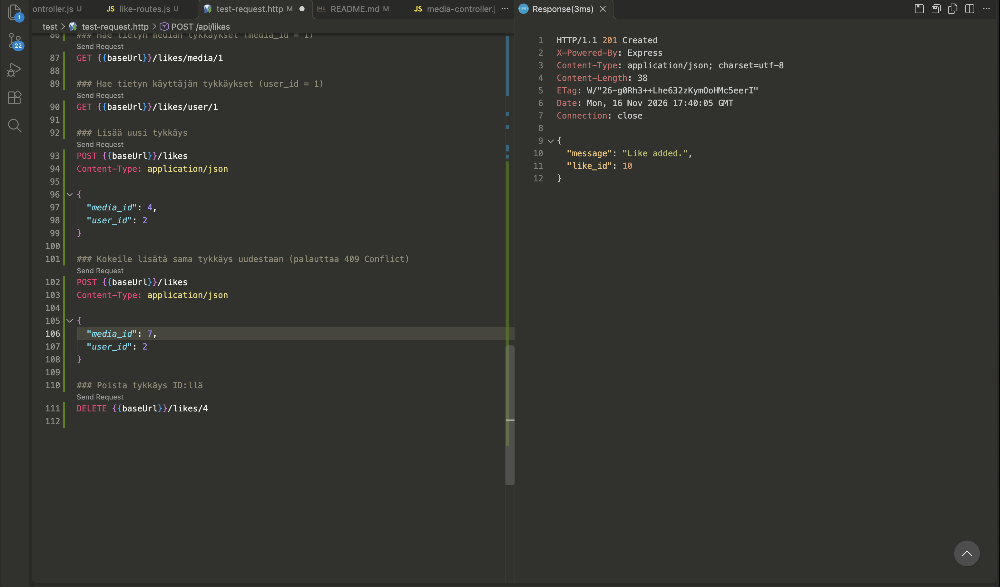
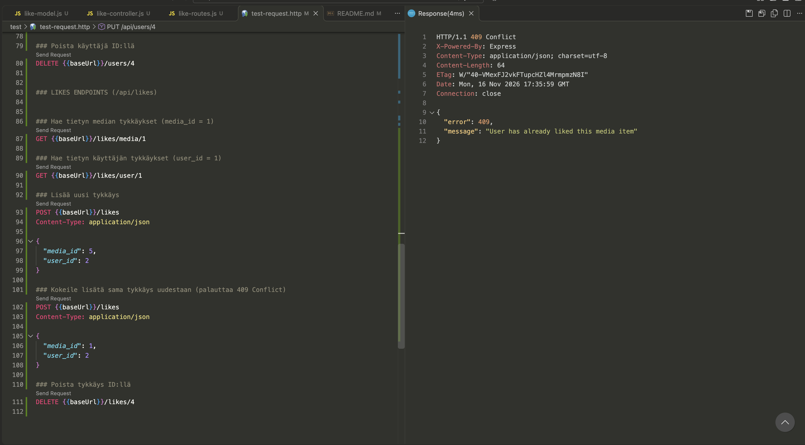

# Node API example

Simple backend server using Node.js

Eri viikkojen esimerkit löydät omista kehityshaaroistaan.

## Express-db

Sain tehtyä kaikki osiot. Api toimii hyvin.

### MVC Suunnittelumalli (Model-View-Controller)

Lyhyt kuvaus toiminnasta:

Sovellus on node.js ja express-pohjainen Rest-api, joka tallentaa dataa Maria-db tietokantaan. Totetus noudattaa modulaarista MVC-arkkitehtuuria.

Routers vastaanottavat HTTP-pyyntöjä (media, users, likes) ja ohjaavat ne omille käsittelijöilleen, express Routerin avulla.

Välissä on middlewarea, kuten multer- middleware (upload.js), joka käsittelee kuvat muotoon, jossa ne voi tallentaa tietokantaan.

Controllersit käsittelevät syötteet ja palauttavat HHTP-statuskoodit ja JSON-muotoiset vastaukset.

Models suorittavat varsinaiset SQL-kyselyt tietokantaan. Ne on tehty tavalla, joka suojaa SQL-injektioilta (prepared statements).

### Endpoints

Alla listattu endpointit ja joitain kuivia niiden toiminnasta. Kaikki endpointit testattu toimiviksi, vaikka jokaisesta ei ole kuvaa.

Media:

GET /api/media - Listaa kaikki

GET /api/media/:id - hakee yksittäisen id_n perusteella

POST - Tallentaa uuden mediatiedoston tietokantaan

PUT- päivittää olemassa olevaa tiedostoa

Delete - poistaa

Users:
Hyvin pitkälle samat kuin Medialle.

Likes:
GET on mahdollista tehdä yhteen tiettyyn mediatiedostoon tai yksittäisen käyttäjän tekemiin tykkäyksiin.
POST tekee uuden tykkäyksen
DELETE poistaa tykkäyksen

Käyttäjä voi tykätä mediaItemistä vain kerran, toinen kerta on estetty, ellei ensin poista tykkäystä.

