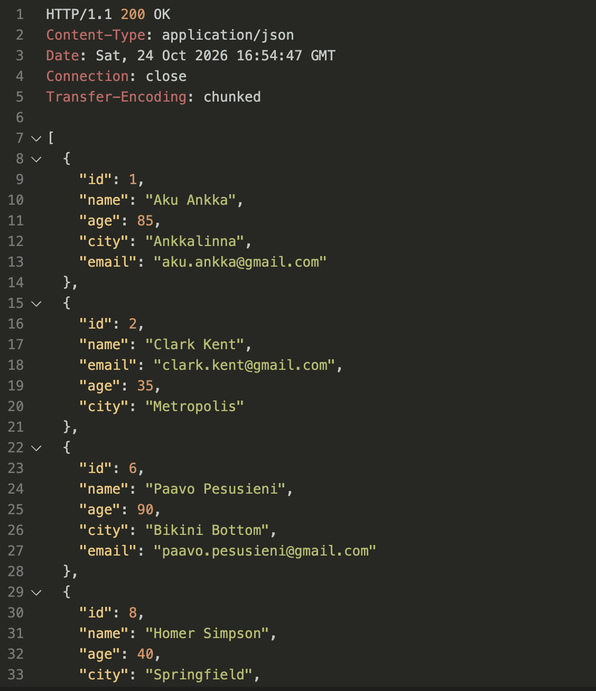
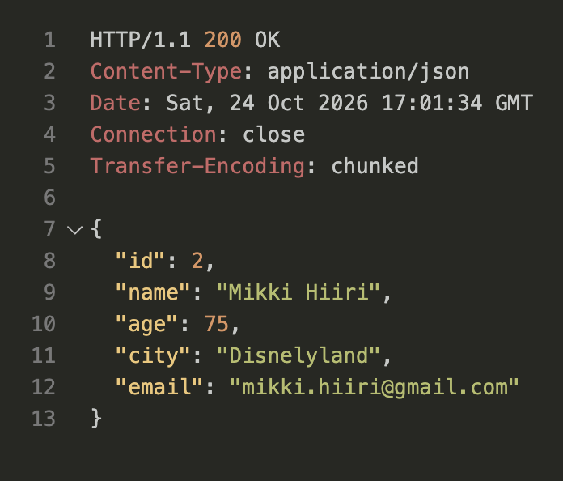
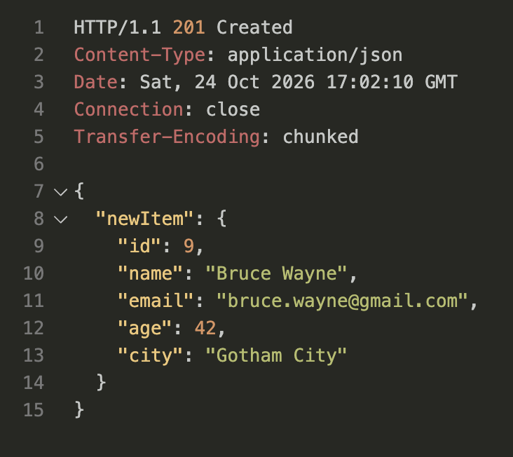
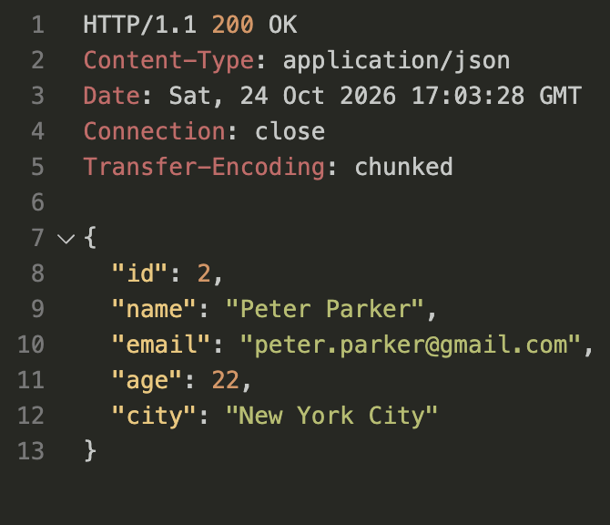

# Node API example

Simple backend server using Node.js

Eri viikkojen esimerkit löydät omista kehityshaaroistaan.

## node start

Basic dummy web-palvelin ja yksinkertaisella reitityksellä.

Sain tehtyä kaikki osiot. Loin node.js projektin ja konfiguroin package.json ja eslintin yms. Nodemon myös asennettu ja käytössä. Gitrepo ja .gitignore luotu. Dummy REST API implementoitu ja GET, POST, PUT ja DELETE request funktiot luotu omiin moduuleihinsa. Testattu rest clientilla.

Apin toiminnallisuudet:
Api käsittelee sarjakuvahahmojen henkilötietoja ja generoi jokaiselle hahmolle automaattisesti sähköpostiosoitteen. Apiin voi lähettää uutta tietoa, joka tallennetaan backendiin. Voi myös muokata jo olemassa olevan hahmon tietoja PUT metodilla.

GET_all:

GET_item_by_id:

POST:

PUT:

