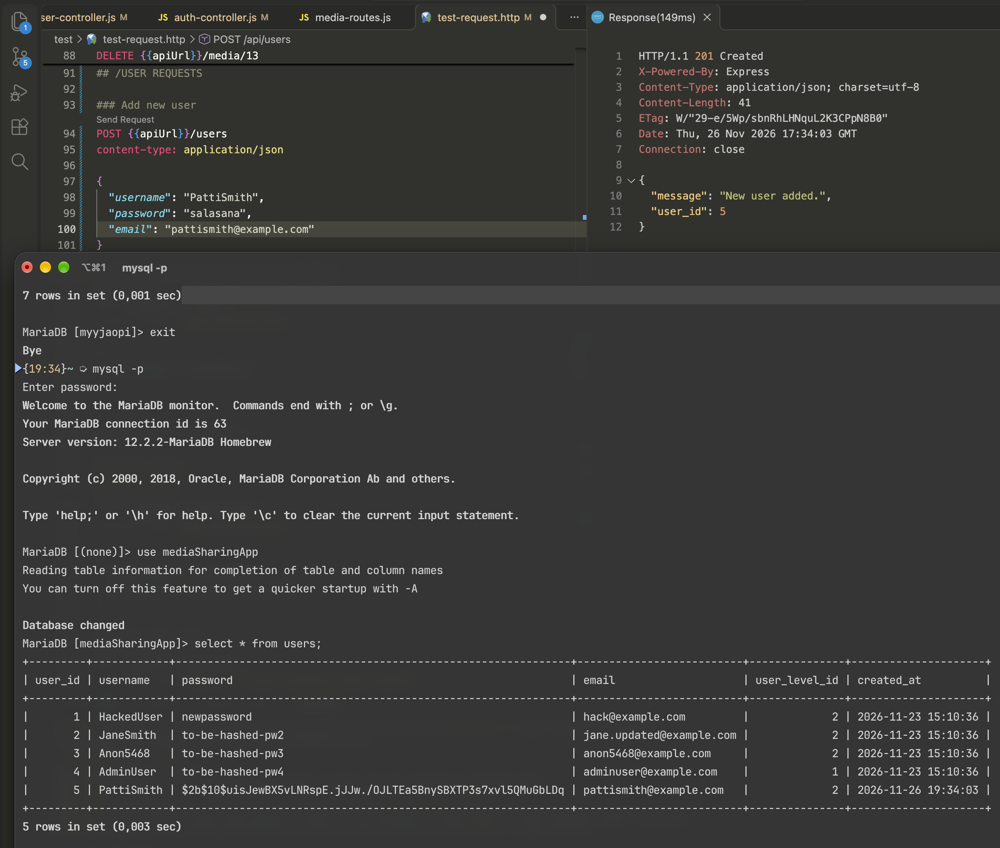
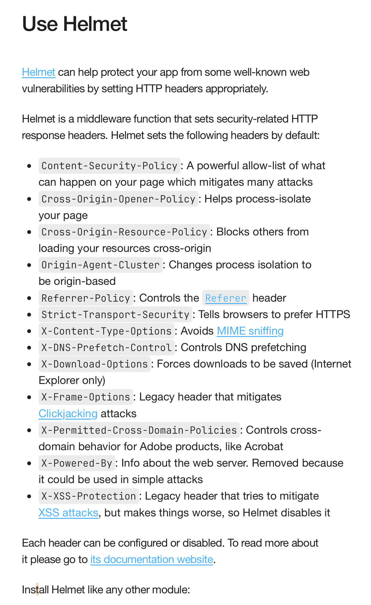
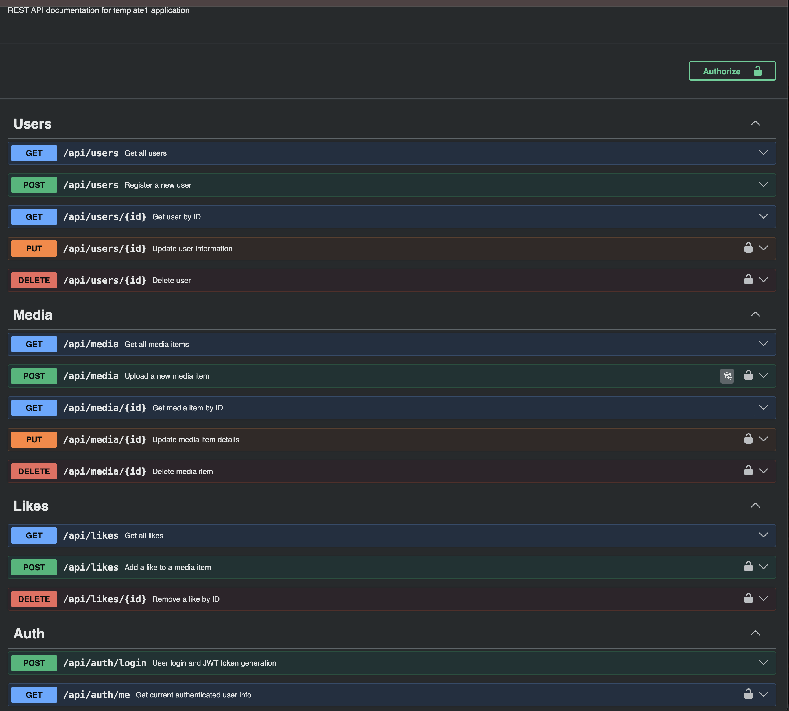

# Node API example

Simple backend server using Node.js

Eri viikkojen esimerkit löydät omista kehityshaaroistaan.

## Security

Sain tehtyä kaikki tehtävät security ja documentation osioista ja tein ne molemmat tähän security kehityshaaraan.

Tein salasanojen hashauksen bcryptjs paketilla.

Otin myös käyttöön CORSin, joka mahdollistaa Cross-origin resource sharing eli eri palvelimien välisen viestinnän ja tiedon jakamisen. Tämä on otettu käyttöön myös projektissa, front-end Vite konfauksen takia.

Latasin ja otin käyttöön HELMETin, joka mm. piilottaa Express headerin vastauksista, jotta mahdollinen hyökkääjä ei tiedä jyväksikäyttää express haavoittuvuuksia.

Otin käyttöön myös express-rate-limitin, jonka asensin auth-login reitille midllewareksi, rajoittamaan samasta ip-osoitteesta tulevien pyyntöjen määrän kymmeneen per 15 min aikaikkuna.

## Documentation

Otin käyttöön swaagger dokumentaation, koska olin tutustunut siihen ja ottanut sen käyttöön projektissa jo ennen tätä tehtävää. Dokumentaation voi käydä katsomassa /api-docs endpointissa.

