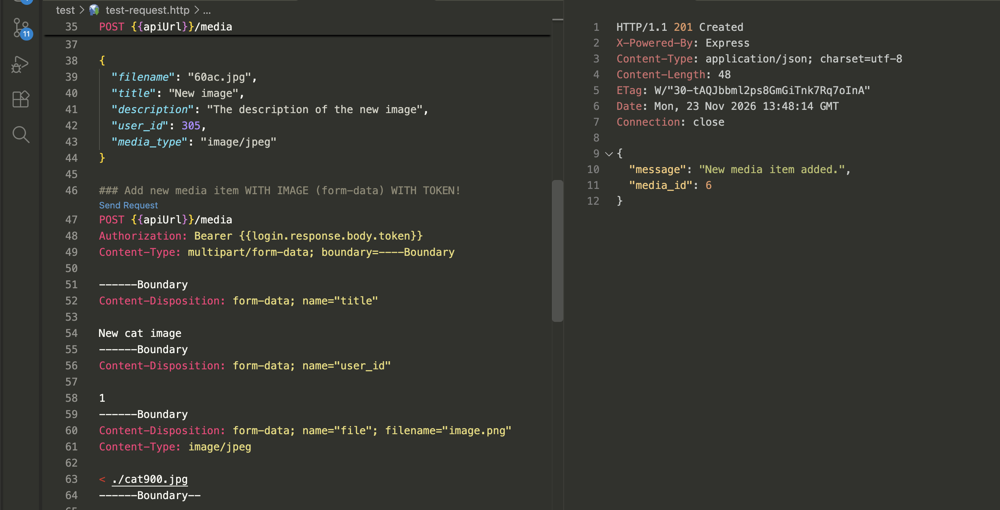
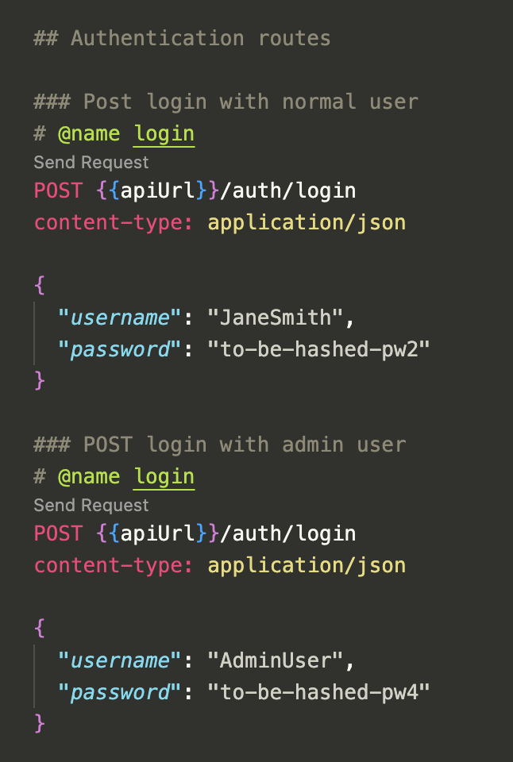
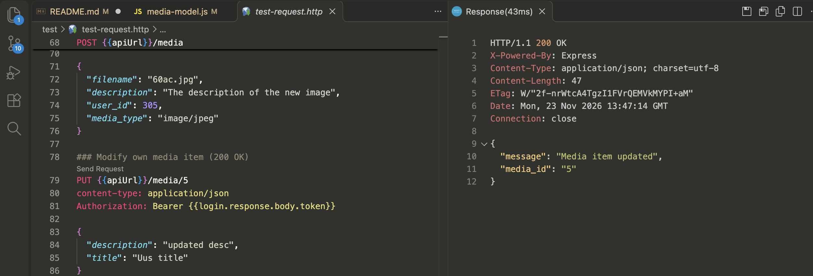

# Node API example

Simple backend server using Node.js

Eri viikkojen esimerkit löydät omista kehityshaaroistaan.

## authentication

Sain tehtyä kaikki osiot kaikki devauksen aikana ilmenneet ongelmat korjattu ja toimii nyt toivotulla tavalla. Yksi ongelma oli tietokannan viite-eheys mediadataa poistaessa, jolloin kommentit estivät datan poiston. Muutin tietokantaa niin, että lisäsäin ON DELETE CASCADE viiteavaimiin, jotta poistaminen onnistuu suoraan madiaDatan poistamalla (tietokanta poistaa loput automaattisesti).

Tässä haarassa toteutettu käyttäjätasoon perustuva JWT authentication. Käyttäjätasoja ovat 2=peruskäyttäjä ja 1=admin. Omistajuus/admintaso tarkistetaan aina kyseisellä reitillä, jotta vain resurssin omistava käyttäjä voi muokata, poistsaa tai päivittää dataansa. Admin oikeudet mahdollistavat minkä tahansa datan muokkaamisen ja poistamisen.

### KUVIA TOIMINNASTA

Kuvia vain muutaman, koska käyttäjätasojen välillä ei kuvissa näy mitään eroa, mutta ne on testattu toimiviksi.

