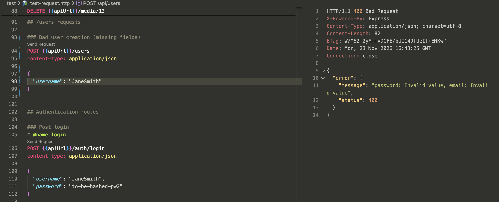
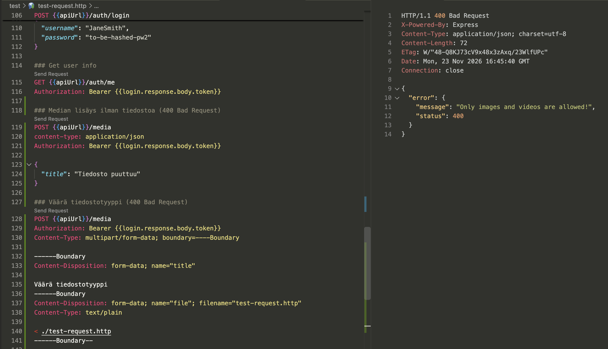

# Node API example

Simple backend server using Node.js

Eri viikkojen esimerkit löydät omista kehityshaaroistaan.

## Validation

Kaikki osat tehty. Syötteet sanitoitu ja validoitu. Tässä haarassa ei ole toteutettu autentikaatiota kokonaan eikä käyttäjätasojen hallintaa.

Virheet käsitellään oikeaoppisesti validationErrors middlewarella, jotta virheellinen data ei päädy tietokantaa ja siitä lähtee asianmukainen virheviesti. Olemattomat reitit määritelty kaikkien oikeiden API-reittien jälkeen ja niistä lähetetään 404 status. Multer ottaa nyt vastaan vain alle 10mb kokoisia tiedostoja ja estää suurempien latauksen virheviestillä höystettynä.

# Kuvia APIn toiminnasta

Seuraavat kuvat ovat virheellisistä syötteistä

