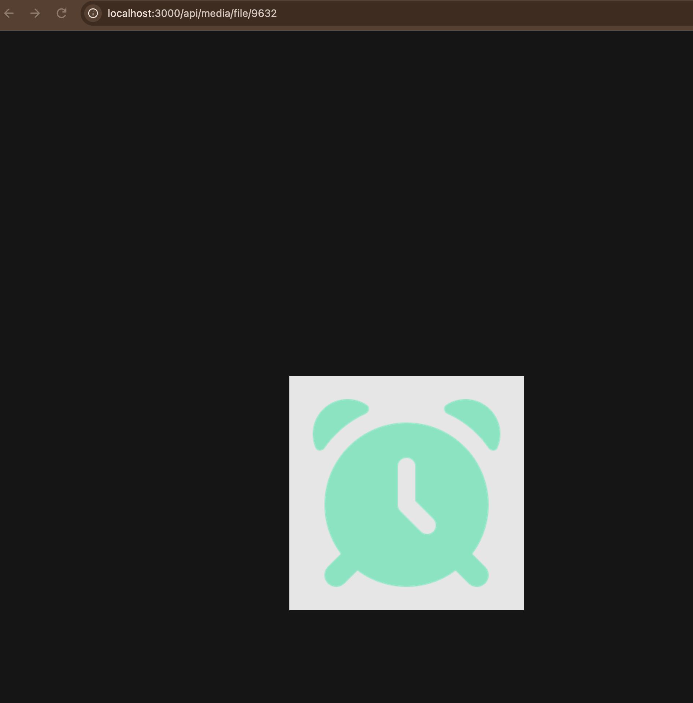
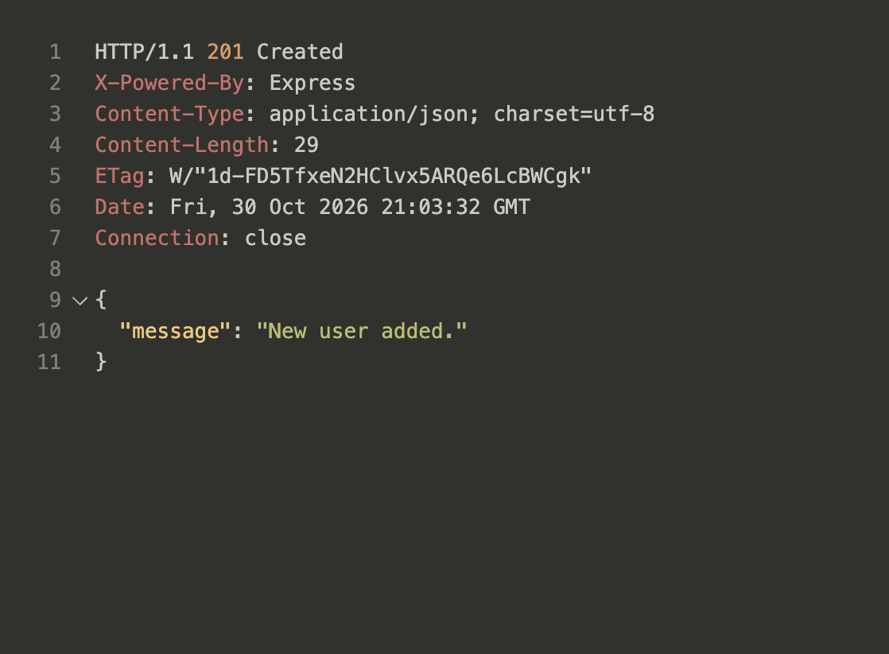
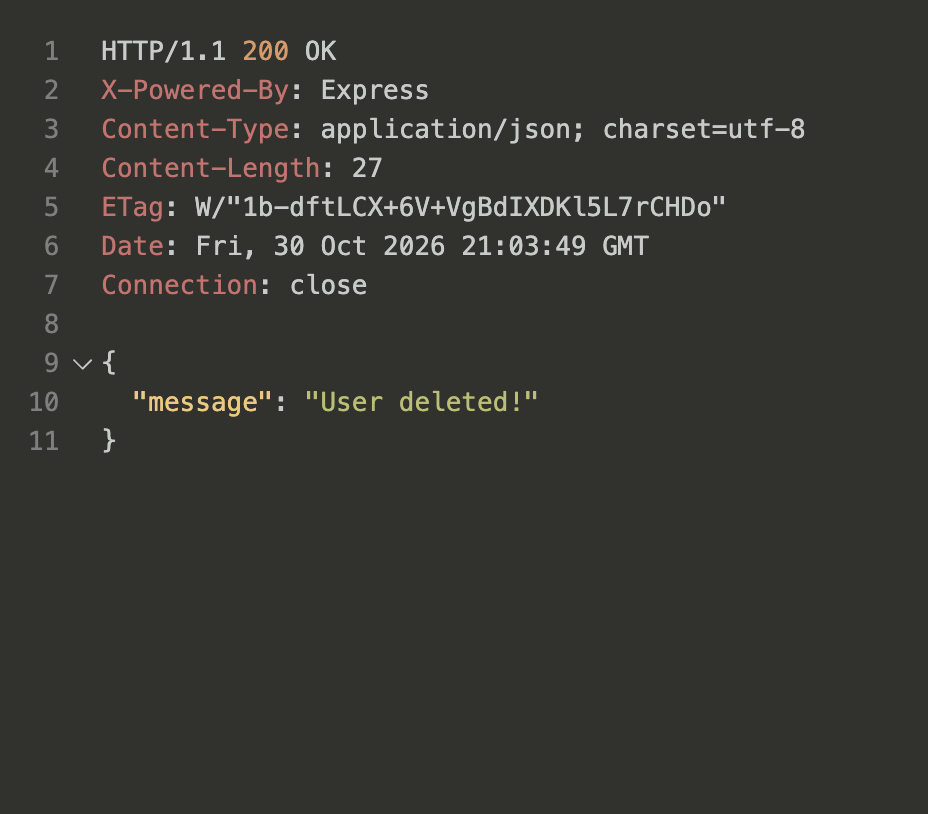
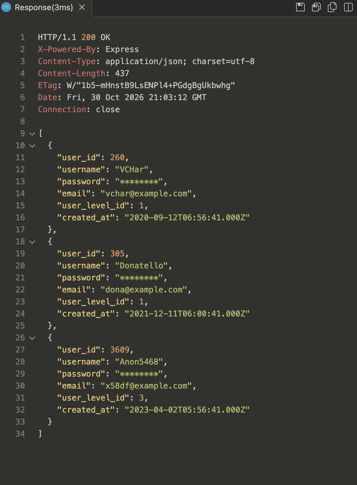
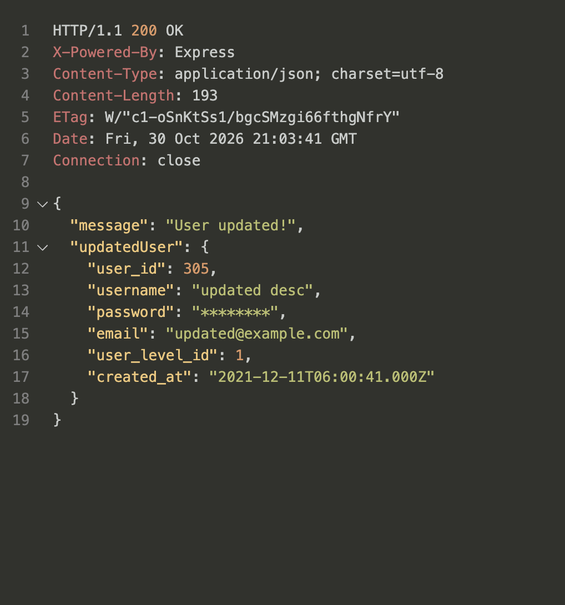

# Node API example

Simple backend server using Node.js

Eri viikkojen esimerkit löydät omista kehityshaaroistaan.

## Express

Sain kaikki osiot tehtyä ja api toimii ongelmitta. Itemin kuvan voi hakea itemin ID:llä tai selaimessa /api/media/file/kuvan_nimi

media.js ja users.js kommentoitu jsDocs tyylillä.

PUGilla tehty 'dynamic content rendering'.

Kuvia apin toimimmasta:

- Kuvan hakeminen itemin id:llä. Toimii myös REST Client avulla VS Codessa.
  

- Users querys
  
  
  
  
  
